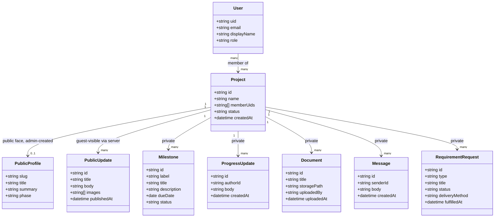

# Client portal: conceptual design (v2, post-review)

**Status: concept only, no implementation yet.** This lives in the same repo as the existing portfolio (Next.js), extended with Firebase (Auth, Firestore, Storage, Cloud Functions) as new dependencies, not a separate app/repo. This document is the design record to follow when implementation starts; it is not itself an implementation plan.

## Context

The portfolio site is used to win freelance engineering work. The goal is a second layer on top of it: a way to show the real, ongoing experience of working with a client (the actual collaboration and progress), beyond a static case study, while guaranteeing that nothing private about a project or client ever leaks to the public.

Traditional proposals (scope/timeline/pricing sent to a prospect before signing) stay outside this system entirely, handled the way they are today. This system starts only once a client has signed.

## Actors

- **Guest**: any anonymous visitor, sees only what has been deliberately published
- **Client**: a signed client, authenticated, sees the full private record of their own project(s); a project can have several client members (co-founders, a client-side PM)
- **Admin** (Reda): manages all clients, projects, and public/private content

## Use cases

**Guest**
- Browse a project's public page: title, one-line summary, generalized phase indicator, and the public journal (a running narrative of what has been shared about that project)

**Client**
- View their project dashboard and status
- View milestones and the private progress log
- View and download documents
- Message the admin, scoped to their project
- See open requirement requests (what is needed from them) and fulfill them
- Receive an email notification when the admin messages them or opens a requirement request
- Implicitly can also see everything a Guest can see about their own project

**Admin**
- Create clients and projects, manage project members
- Update milestones, post private progress updates, upload documents
- Create requirement requests, message clients
- Receive an email notification when a client sends a message or fulfills a requirement
- Write public journal entries, set the project's public phase label, create or remove a project's public profile
- Cross-project overview dashboard

## Core design principles

### Public content is opt-in by construction

Private project data and public content are **separate documents**, not one dataset with a visibility flag. A flag defaults to "forgot to mark it private" as a failure mode; separate, deliberately-authored public documents mean nothing is exposed unless the admin took the explicit action of creating it. A project has no public face at all until its public profile document exists. There is no shared "toggle visibility" mechanism anywhere in the system.

### Public data is served only through the server

Guest pages are rendered by Next.js on the server using the Firebase Admin SDK. Firestore itself stays **fully closed to unauthenticated access**: there are no `allow read: if true` rules anywhere. Benefits: the database is never exposed to direct anonymous traffic, and public journal pages are server-rendered HTML with proper SEO, which matters for a portfolio whose public pages exist to be found. The client portal, by contrast, uses the client SDK (realtime updates for messages and progress); guests need no realtime.

### No secrets in the database, ever

`RequirementRequest` never stores an actual secret value (API key, credential). It only tracks what is needed and whether it has been provided through a separate, out-of-band channel. Hard constraint, unchanged from the first draft.

### Consent is deferred, deliberately

There is no client-consent workflow for public content in this version. The admin is responsible for publishing responsibly. Known risk accepted for now: NDA-bound clients require checking the contract before creating a public profile for their project. If this ever becomes a friction point, the natural upgrade path is an in-portal approval flow (entries drafted, client approves before publish), which the two-document design already accommodates without restructuring.

## Domain model



Notes:
- `memberUids` is an array so a client team (two founders, a PM) can share one project without a future migration. Rules check membership with `in`.
- `PublicProfile.phase` is a small fixed vocabulary (Discovery, Build, QA & Launch, Completed), set manually by the admin, never derived from `Milestone` state, so it cannot inherit internal naming or timing specifics.
- `PublicProfile` is optional (0..1): its absence is what "this project is not public" means. No flag.

## Firestore schema

```
/users/{uid}
    email, displayName, role ('admin' | 'client'), createdAt

/projects/{projectId}
    name, memberUids[], status, createdAt          -- private, no public fields here

    /projects/{projectId}/public/profile           -- singleton doc, admin-created
        slug, title, summary, phase                -- guests via Admin SDK; members may read

    /projects/{projectId}/publicUpdates/{updateId} -- guests via Admin SDK; members may read
        title, body, images[], publishedAt

    /projects/{projectId}/milestones/{milestoneId}      -- private
    /projects/{projectId}/progressUpdates/{updateId}    -- private
    /projects/{projectId}/documents/{documentId}        -- private, metadata only
    /projects/{projectId}/messages/{messageId}          -- private
    /projects/{projectId}/requirementRequests/{reqId}   -- private
```

The public face lives in its own documents (`public/profile`, `publicUpdates`) rather than as fields on the project document. This is required, not stylistic: **Firestore rules cannot grant field-level reads**; document reads are all-or-nothing, so public and private data must never share a document. In this design it is moot for guests (who never touch Firestore directly), but it also keeps client-side reads clean and preserves the option of opening public reads later without leaking `memberUids`.

Storage layout: `/projects/{projectId}/documents/{documentId}/{filename}` for private files, `/projects/{projectId}/publicUpdates/{updateId}/{filename}` for journal images (served via the server or signed URLs, same closed-by-default posture).

### Security rules shape

Implemented in `firestore.rules` with an executable test suite at `tests/rules/firestore-rules.test.ts` (run with `npm run test:rules`). The rules file is the source of truth; this section records the shape.

- No unauthenticated read or write anywhere. Guest traffic never reaches Firestore.
- Private subcollections: ownership lives **only** on the project document; child documents do not denormalize membership. Rules resolve it via a `get()` lookup on the project's `memberUids` (one extra document read per access, fine at this scale).
- Rules are verb-split per collection, narrower than "members read and write". Members read everything in their project but their writes are exactly two: creating a message with their own uid as `senderId` (sender spoofing is denied for everyone, admin included), and fulfilling a requirement request, where the update may touch only `status` and `fulfilledAt` and may only set `status` to fulfilled. That key allowlist is also the no-secrets guard: a client cannot attach a value field. Milestones, progress updates, documents, and all public content are admin-only writes.
- `public/profile` and `publicUpdates`: admin-only write. Project members may read their own project's public docs through rules (a client sees everything a guest sees). Unauthenticated reads stay denied; guests are served by the Admin SDK on the server, which bypasses rules.
- `/users/{uid}`: a user reads their own doc, admin reads all. No self-writes of any kind, which closes the role escalation path. User docs are created only via the Admin SDK.
- `isAdmin()` checks a custom auth claim. Claims are set server-side; the first admin claim is bootstrapped once by a local script using the Admin SDK (service account), never through the app.

## Notifications (core concept, not an add-on)

The portal only works as a communication channel if each side learns that something happened. A Cloud Function triggers on writes and sends email through a transactional email provider (pick at implementation time):

- New `Message` by admin → email to project members. New `Message` by client → email to admin.
- New `RequirementRequest` → email to project members. Requirement fulfilled → email to admin.
- New `ProgressUpdate` by admin → email to project members (digest or immediate, decide at implementation).

No in-app notification center in v1; email is the whole mechanism.

## Relationship to the existing portfolio content

Same repo, same Next.js app. The current static project list (`src/app/projects/page.tsx`, hand-maintained per CLAUDE.md conventions) stays exactly as is. This system is additive: new routes for the client portal (e.g. `/portal`) and for server-rendered public journal pages get layered alongside the existing static pages. Which projects get a Firestore-backed record (and therefore a live public journal) versus staying a plain static case study is a per-project decision, not a migration.

Resolved: the guest-facing URL scheme is `/work/{slug}`, shared with the static case studies. `/projects` was renamed to `/work` (with permanent redirects in `next.config.mjs`) and the two kinds of page coexist in one namespace: static MDX segments are case studies and take routing priority, while `/work/[slug]` falls through to a project's public profile in Firestore. Live projects are listed on the `/work` index and included in `src/app/sitemap.ts`, so they are discoverable rather than link-only. That is a deliberate choice in favour of the portfolio's purpose, and it raises the stakes on the NDA risk accepted above: a public profile must not be created for a project whose contract forbids it.

## Decisions log

- No proposal entity; proposals stay traditional, outside the system
- Public journal plus generalized phase indicator for guests (not journal-only)
- Same repo as the portfolio
- Public content served server-side only; Firestore closed to anonymous access
- No client-consent workflow for now (accepted risk, upgrade path exists)
- Email notifications are core scope
- `memberUids` array instead of single `clientUid`
- Client sign-in v1 is email/password via the client SDK; email-link and password reset deferred
- Admin surface is a panel inside this app at `/portal/admin`, gated by the admin custom claim
- Client accounts are created through `POST /api/admin/clients`, an authenticated route using the Admin SDK. It is the only server-side write surface; everything else is client SDK under the rules
- Messages carry a denormalized `senderName` so both viewers can label a thread without extra reads (clients cannot read other users' docs)
- The portal is a standalone dashboard shell with a persistent sidebar, and each project section is its own route. It does not render the marketing site's header or footer, which is why the marketing pages moved into a `(site)` route group
- Guest URL scheme is `/work/{slug}`, listed on the index and in the sitemap. Guest reads go through `src/lib/work/publicProjects.ts` (Admin SDK, server only), which returns empty rather than throwing when no Firebase credentials are configured, so a build without a Firebase project still ships the static case studies

## Remaining open items

- Document constraints: size/type limits, preview vs download-only
- Email provider choice and digest-vs-immediate for progress updates
- Public profile slugs are free text today, so an admin can save one containing spaces. `/work/[slug]` decodes the route param to cope, but the admin form should probably enforce a slug format

## Next steps

When ready to build, run a separate implementation planning pass covering: Firebase project setup within this repo, Auth flow, the actual rules file, Cloud Functions for claims and notifications, new routes, and initial screens. That pass should treat this document as fixed requirements unless something here proves wrong in practice.
