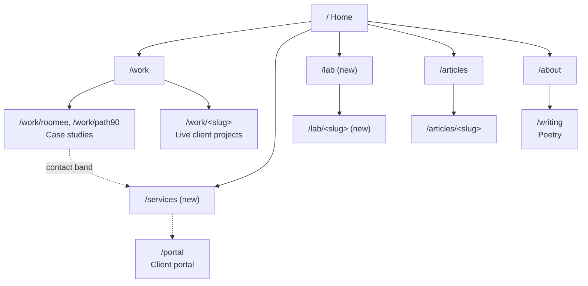

# Sitemap

**Status: partly built.** Home, `/services`, the header, the CV footer, and About are live in the new design; `/thank-you` is gone. `/work`, case studies, and articles have the new colors and fonts but keep their old layouts. **`/lab` is deferred:** no route and no nav link until there is a first experiment, so the header, footer, and Home leave it out for now. Positioning and copy rules live in `docs/brand.md`; the visual system is recorded there too.

## Tree

```
/                         Home
├── /work                 Work index: Case studies and projects, then In progress
│   ├── /work/roomee      Case study (MDX)
│   ├── /work/path90      Case study (MDX)
│   └── /work/<slug>      Live client project (Firestore public journal)
├── /services             Services and how I work                       NEW
├── /lab                  Lab index                                     NEW
│   └── /lab/<slug>       One experiment: live demo plus a short note    NEW
├── /articles             Articles index
│   └── /articles/<slug>  Article (MDX)
├── /about                About
├── /writing              Poetry (footer and About only)
├── /accessibility        What the site supports, Display preferences, how to report a barrier
└── /portal               Client portal (separate shell, unchanged)

Removed:  /thank-you (template leftover, there is no newsletter)
Machine routes, unchanged:  /feed.xml, /og, /sitemap.xml, /api/admin/clients
```



Solid lines are header navigation and index links. Dotted lines are in-page links.

## Navigation

**Header** (freelance first): Work, Services, Articles, About, scrolling in a compact marquee in the middle of the header, with the current page in coral (Lab joins after Articles once it exists). Phones get the same list in the Menu popover instead. A **Start a project** button sits at the end and goes to `/services#contact`.

**Footer:** Work, Services, Articles, About, Writing, Accessibility (Lab joins once it exists), Client portal sign-in (`/portal/sign-in`), the email address, and socials (GitHub, LinkedIn, X). Above those links sits the CV (Education, Experience, Skills, Certifications): four open columns from `lg`, four closed disclosures below it so the CV doesn't add two screens to every page on a phone.

`/writing` stays out of the header on purpose, as before.

## Pages

Each entry gives the page's purpose, its reader, its sections in order, the one action it drives, and where its data comes from.

### Home `/` (existing, rewritten)
- **Purpose:** the front door. A visitor knows within one screen what I do and who it's for.
- **Reader:** both audiences, freelance clients first.
- **Sections:**
  1. Hero: headline, one-liner, Start a project, Download CV
  2. Selected work: the two case studies plus any live projects
  3. Services teaser: the three kinds of engagement, linking to `/services`
  4. From the Lab: two highlighted experiments
  5. Contact band
- **Not on Home:** articles, on purpose. They are reachable from the header and footer.
- **Phones:** the project row swipes sideways with the next card peeking in and the role split keeps both lists side by side under a smaller pie.
- **Primary action:** Start a project.
- **Data:** `workProjects` (`src/lib/work/projects.ts`), `listPublicProjects()` (`src/lib/work/publicProjects.ts`), Lab entries.

### Work index `/work` (existing, restructured)
- **Purpose:** show range and depth.
- **Reader:** hiring managers first, clients checking credibility.
- **Sections:**
  1. Case studies and projects: everything in `workProjects`. Case studies link inward and the rest link out.
  2. In progress: live client projects from `listPublicProjects()`, each with its phase label.
- **Primary action:** open a case study.

### Case study `/work/roomee`, `/work/path90` (existing)
- **Purpose:** show how I make decisions.
- **Sections:** follow the seven-section structure in `docs/case-study.md`, then prev/next project, then the contact band.
- **Primary action:** Start a project, or the next case study.
- **Data:** MDX, with metadata from `caseStudyMetadata()`.

### Live project `/work/<slug>` (existing)
- **Purpose:** show real, ongoing client work as it happens.
- **Sections:** title, summary, phase, public journal. Only the shared site chrome changes.
- **Data:** `src/app/(site)/work/[slug]/page.tsx`, reading the portal's public face.

### Services `/services` (new)
- **Purpose:** turn a prospective client into an email.
- **Reader:** founders and teams hiring for product work.
- **Sections:**
  1. What I take on: new product builds, UX and front-end overhauls of existing products, ongoing engineering
  2. How I work: the four steps from `docs/brand.md`
  3. The client portal: what clients see (milestones, documents, messages, requests) as a working sample
  4. Outcomes: short links to the case studies
  5. FAQ: timelines, how pricing works, stack
  6. Contact (`#contact`): the email address and what to include in a first message
- **Primary action:** email me.

### Lab index `/lab` (new)
- **Purpose:** the main proof of UX engineering craft outside client work.
- **Reader:** both audiences, but especially hiring managers.
- **Sections:** a short intro, then a grid of experiments. Each card shows a live preview or a still, plus one line on what the experiment tests.
- **Primary action:** open an experiment.
- **Data:** Lab entries, found by a glob in a new `src/lib/lab.ts` modeled on `src/lib/articles.ts`.

### Lab entry `/lab/<slug>` (new)
- **Purpose:** one interaction question, answered with something you can use.
- **Sections:** a working demo at the top, then a short note on the question, the approach, and what I learned, then links to related work.
- **Data:** MDX at `src/app/(site)/lab/<slug>/page.mdx`. Each entry declares its own `slug`, the same way articles do.
- **First candidates:** an offline check-in queue (from Path90) and budget-based matching (from Roomee), both using sample data that is labeled as such.

### Articles `/articles`, `/articles/<slug>` (existing, unchanged)
Notes on the craft. Structure and data stay as they are.

### About `/about` (existing, rewritten)
- **Purpose:** the person behind the work.
- **Sections:** background, how I think about the people I build for, experience with a CV download, a link to poetry, contact.
- **Primary action:** Download CV.

### Writing `/writing` (existing, unchanged)
Poetry. Reachable from the footer and About only.

### Portal `/portal` (existing, unchanged)
A separate dashboard shell with its own route map in `src/components/portal/shell/nav.ts`. It appears on the public site only as the footer sign-in link and as the sample on `/services`.

## Still to build
- `/work`: the new layout, split into the two sections.
- Case study and article layouts in the new design.
- `/lab`: `src/app/(site)/lab/page.tsx`, `src/lib/lab.ts`, the first entries, then add it to the header, footer, marquee, Home, and `src/app/sitemap.ts`.

Done: `/services`, navigation in `src/components/Header.tsx` and `src/components/Footer.tsx`, `/services` in `src/app/sitemap.ts`, and `/thank-you` deleted.
